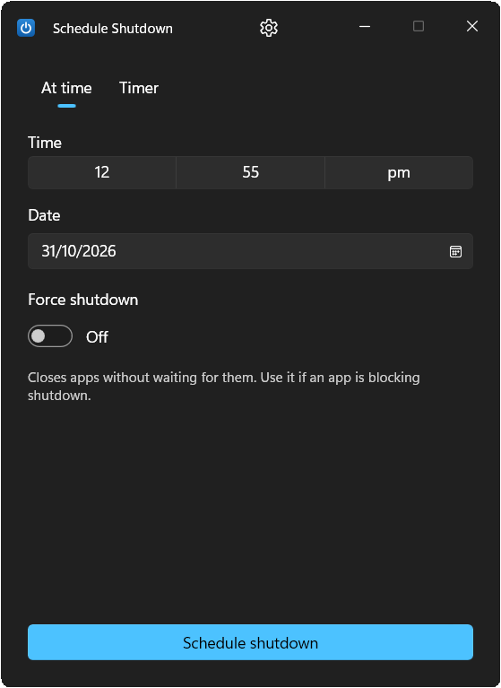
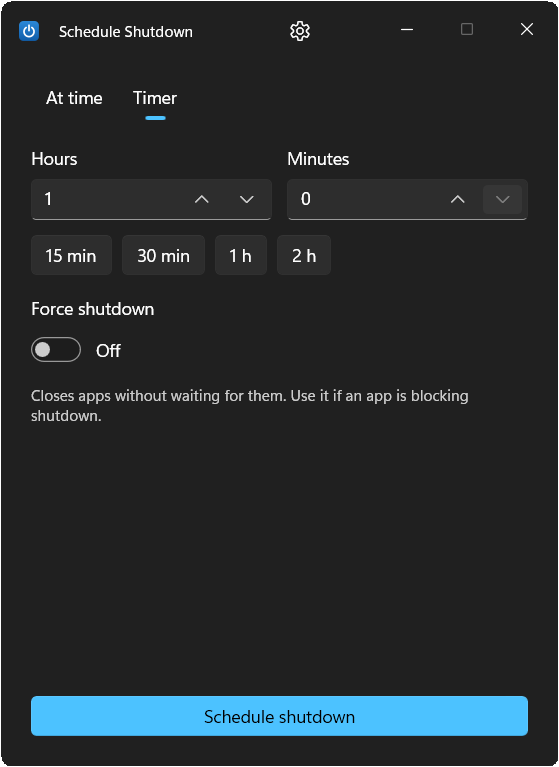
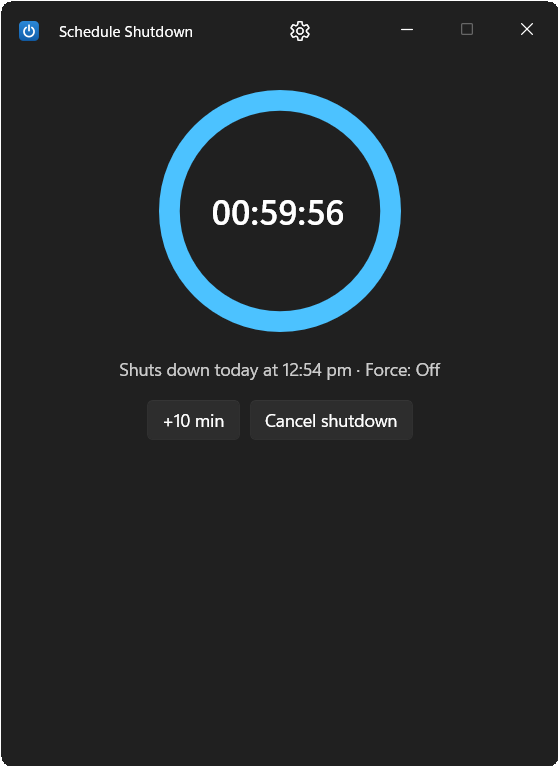

<p align="center">
  
</p>

<h1 align="center">Schedule Shutdown for Windows 11</h1>

<p align="center">
  <b>A free, open-source shutdown timer for Windows 11.</b><br>
  Shut down your PC at an exact time or after a countdown, with an optional force shutdown for when apps get in the way.
</p>

<p align="center">
  <a href="https://github.com/Navojith/schedule-shutdown/releases/latest"></a>
  
  
  
  <a href="LICENSE"></a>
</p>

---

**Schedule Shutdown** is a small Windows 11 desktop app that turns your computer off for you. Pick a time ("shut down at 23:30") or set a timer ("shut down in 1 hour 30 minutes"), and Schedule Shutdown takes care of the rest: it counts down, warns you before it happens, and lets you cancel or postpone at any moment. You don't need to remember `shutdown -s -t 3600` commands or set up Task Scheduler.

It's handy when you leave a download, a render, a game update or a backup running overnight, when you fall asleep watching something, or when you just want your PC to turn itself off at a set time.

<p align="center">
  
  
  
</p>

## Contents
- [Features](#features)
- [Download and install](#download-and-install)
- [How to schedule a shutdown](#how-to-schedule-a-shutdown)
- [Why not just use `shutdown -s -t`?](#why-not-just-use-shutdown--s--t)
- [FAQ](#faq)
- [Build from source](#build-from-source)
- [Contributing](#contributing)
- [License](#license)

## Features

- **Shut down at a specific time.** Pick a time and date. If that time has already passed today, the shutdown is scheduled for tomorrow.
- **Shutdown timer (countdown).** Set hours and minutes, or use the quick presets: 15 min, 30 min, 1 h, 2 h.
- **Optional force shutdown.** Closes apps without waiting for them, so a frozen app or a "Save changes?" dialog can't block the shutdown. It's off by default and always shows a warning that unsaved work will be lost.
- **Live countdown.** A progress ring shows the time left and when the PC will shut down.
- **Cancel or postpone at any time.** One click cancels the shutdown, and **+10 min** pushes it back.
- **Warnings before shutdown.** Windows notifications appear 10 minutes and 1 minute before, then a 60-second on-screen countdown with **Cancel** and **Postpone** buttons.
- **Runs in the system tray.** Closing the window keeps the timer running in the tray. Hover the tray icon to see the time left, or right-click it to open the app, cancel the shutdown or exit.
- **Survives restarts and sleep.** The schedule is saved to disk and restored if the app is closed and reopened. If the PC wakes up after the shutdown time has passed, you get the 60-second countdown first instead of an instant shutdown.
- **Modern Windows 11 design.** Native Fluent UI (WinUI 3) with Mica, light and dark theme, keyboard and screen-reader support.
- **Free and lightweight.** No ads, no account, no telemetry, and no admin rights needed to schedule a shutdown.

## Download and install

1. Go to the [**latest release**](https://github.com/Navojith/schedule-shutdown/releases/latest).
2. Download `ScheduleShutdown-x64.msi`.
3. Run the installer. Schedule Shutdown is added to the Start menu.

**Requirements:** Windows 11 (x64). No separate .NET or Windows App SDK install is needed: everything the app needs is bundled.

> **Windows SmartScreen:** the installer isn't code-signed yet, so Windows may show "Windows protected your PC". Click **More info → Run anyway** to continue.

To uninstall, go to **Settings → Apps → Installed apps → Schedule Shutdown → Uninstall**.

## How to schedule a shutdown

**Shut down at a specific time**
1. Open **Schedule Shutdown** from the Start menu.
2. Choose **At time** and pick the time (and date, if not today) you want the PC to turn off.
3. Click **Schedule shutdown**.

**Shut down after a timer**
1. Choose **Timer**.
2. Enter hours and minutes, or click a preset (15 min, 30 min, 1 h, 2 h).
3. Click **Schedule shutdown**.

**Cancel a scheduled shutdown:** click **Cancel shutdown** in the app, right-click the tray icon and choose **Cancel shutdown**, or click **Cancel** on the warning notification or the final countdown.

## Why not just use `shutdown -s -t`?

Windows has a built-in way to schedule a shutdown from the command line:

```powershell
shutdown -s -t 3600   # shut down in 1 hour
shutdown -a           # cancel it
```

It works, but it has some catches:

- **Any timeout above 0 implies `/f` (force).** Microsoft's documentation says `/t` with a value greater than 0 always forces running apps to close, so unsaved work can be lost without asking.
- You have to convert the time into seconds yourself, and there is no easy way to see how much time is left.
- There's no countdown, tray icon or postpone button, and it's easy to forget a shutdown is pending.

Schedule Shutdown keeps its own timer and only calls `shutdown /s /t 0` at the exact moment, adding `/f` **only** if you turned on force shutdown. You get a clear countdown, warnings, and a real choice between a normal and a forced shutdown.

## FAQ

**How do I schedule a shutdown in Windows 11?**
Install Schedule Shutdown, choose **At time** or **Timer**, and click **Schedule shutdown**. The PC turns off at the time you picked, after warning you first.

**Can I make my PC shut down automatically at night?**
Yes. Choose **At time**, pick the time (for example 01:00), and leave the app running in the tray. If the time has already passed today, it schedules for tomorrow.

**What happens to my open apps and unsaved files?**
With force shutdown **off** (the default), Windows shuts down normally, and apps can still ask you to save. With force shutdown **on**, apps are closed without saving. Use it only when you're sure nothing important is open.

**What if my PC is asleep at the scheduled time?**
When it wakes up, Schedule Shutdown notices the time has passed and shows a 60-second countdown instead of shutting down immediately, so you can cancel. Schedules more than 12 hours overdue are discarded.

**Does it need administrator rights?**
No. Shutting down your own PC doesn't need admin rights. The installer itself asks for permission because it installs to Program Files.

**Does closing the window cancel the shutdown?**
No. Closing the window hides the app in the system tray and the timer keeps running. To stop it, cancel the shutdown or choose **Exit** from the tray menu (you'll be asked to confirm).

**Can it restart, sleep or hibernate instead?**
Not yet. Restart, sleep, hibernate and sign out are planned for a future version.

**Does it work on Windows 10?**
It's built and tested for Windows 11 only.

**Where are settings and logs stored?**
In `%LOCALAPPDATA%\ScheduleShutdown\` (`state.json`, `settings.json` and `app.log`).

## Build from source

Requirements: Windows 11 x64, [.NET 9 SDK](https://dotnet.microsoft.com/download/dotnet/9.0), and (for the installer) [WiX Toolset v5](https://wixtoolset.org/) (`dotnet tool install --global wix`).

```powershell
git clone https://github.com/Navojith/schedule-shutdown.git
cd schedule-shutdown
dotnet build ScheduleShutdown.sln
dotnet test

# Run in dry-run mode: the shutdown command is logged, not executed
$env:SCHEDULE_SHUTDOWN_DRYRUN = "1"; dotnet run --project src/ScheduleShutdown.App

# Build the MSI installer
dotnet build installer/ScheduleShutdown.Installer -c Release
```

> Always use `SCHEDULE_SHUTDOWN_DRYRUN=1` while developing, or a finished timer **will** shut your PC down.

### Project structure

| Folder | What's inside |
|---|---|
| `src/ScheduleShutdown.Core` | Scheduling logic (pure .NET, fully unit-tested) |
| `src/ScheduleShutdown.App` | WinUI 3 app: views, view models, tray, notifications |
| `tests/ScheduleShutdown.Core.Tests` | xUnit tests |
| `installer/ScheduleShutdown.Installer` | WiX v5 MSI installer |
| `docs/` | [Project plan](docs/PLAN.md) and [manual QA checklist](docs/QA.md) |

Built with C#, .NET 9, WinUI 3 (Windows App SDK), CommunityToolkit.Mvvm and H.NotifyIcon.

## Contributing

Bug reports, feature ideas and pull requests are welcome. Please [open an issue](https://github.com/Navojith/schedule-shutdown/issues) first for larger changes. If Schedule Shutdown is useful to you, a ⭐ on GitHub helps other people find it.

## License

Schedule Shutdown is free and open source under the [MIT License](LICENSE).

---

<sub>Keywords: schedule shutdown, Windows 11 shutdown timer, auto shutdown, automatic shutdown, shut down PC at a specific time, sleep timer for PC, turn off computer timer, scheduled shutdown app, shutdown scheduler, force shutdown, free shutdown timer for Windows.</sub>
